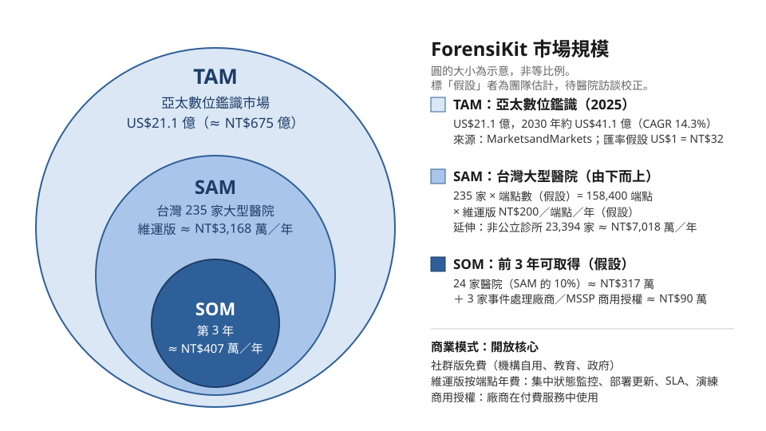

# 市場規模與商業模式

> 負責人：OogaryoO（T18）。初稿資料查詢日期：2026-11-09；定稿與查證：2026-11-13。
> **標示「假設」的數字是團隊自己的估計**，簡報時要明講，並用醫院資訊室訪談校正（訪談題綱見第 8 節）。

## 1. 一句話定位

ForensiKit 是給「沒有專職鑑識人員」的醫院與中型組織用的**事發當下證據保全工具**：平時加大並備份 log，出事時由值班 IT 一鍵匯出指定時段、附雜湊與監管鏈的證據包。它不取代 EDR 或專業鑑識，而是補上「隔離後、專家到場前」的空窗。

## 2. 市場規模

### 2.1 計算方式

- **TAM（由上而下）**：用研究機構的數位鑑識市場規模，說明「這個產業有多大、成長多快」。
- **SAM（由下而上）**：我們的切入點是台灣大型醫院。以「家數 × 每家端點數 × 每端點年費」計算。
- **SOM（假設）**：前 3 年實際拿得到的客戶數 × 單價。

TAM 和 SAM 差了三個數量級是正常的：TAM 是整個鑑識產業（含鑑識服務、行動裝置與雲端鑑識），SAM 只算我們第一個能服務的客群。

### 2.2 TAM：數位鑑識市場

| 範圍 | 規模 | 年複合成長率 | 來源 |
|---|---|---|---|
| 全球數位鑑識（2025） | 約 US$129.4 億 | 約 12%（2025–2030） | [MarketsandMarkets](https://www.marketsandmarkets.com/Market-Reports/geography/digital-forensics-market/Rest-Of-Asia-Pacific) |
| **亞太數位鑑識（2025 → 2030）** | **約 US$21.1 億 → 約 US$41.1 億** | **14.3%**（全球成長最快的區域） | [MarketsandMarkets](https://www.marketsandmarkets.com/Market-Reports/geography/digital-forensics-market/Asia-Pacific) |
| 台灣資安產業產值 | 2024 年突破 NT$817 億，目標 2026 年 NT$1,000 億 | — | [CIO Taiwan](https://www.cio.com.tw/87365/) |

圖中的 TAM 用亞太市場：US$21.1 億，**以 US$1 = NT$32 換算（假設）約 NT$675 億**。

### 2.3 SAM：台灣大型醫院（由下而上）

| 對象 | 家數 | 每家端點數（假設） | 端點數 |
|---|---|---|---|
| 醫學中心 | 22 | 3,000 | 66,000 |
| 區域醫院 | 83 | 800 | 66,400 |
| 地區醫院（健保收入 2 億以上） | 130 | 200 | 26,000 |
| **合計** | **235** | | **158,400** |

- **家數來源**：健保署公布的 2024 年財報對象，即健保費用逾 2 億元的醫療院所［[世界日報](https://www.worldjournal.com/wj/amp/story/121221/9631030)］。家數每年略有變動（歷年財報公開對象總數都在 230–240 家左右），不影響結論；簡報前請以健保署官網「醫事服務機構財報公開」頁面核對最新數字。
- **單價（假設）**：維運版每端點每年 NT$200（內容見第 5 節）。
  - 參考：商用 DFIR 平台 Binalyze AIR 的入門方案是 US$799／月、最多 200 個資產［[Binalyze](https://www.binalyze.com/pricing-enterprise)］，約合每端點每年 US$48（≈ NT$1,500）。我們的定價約為它的 1/7，但功能也只有它的一部分：沒有遠端收集、沒有分析介面。
- **醫院 SAM ≈ 158,400 端點 × NT$200 ≈ NT$3,168 萬／年。**
- **延伸 SAM**：
  - 全台非公立診所 23,394 家（2024 年底）［[工商時報](https://www.ctee.com.tw/news/20250916701207-430601)］。以每家每年 NT$3,000 的單機維運版計，約 NT$7,018 萬／年（假設）。
  - 台灣中小企業 171.6 萬家［[中時新聞網](https://wantrich.chinatimes.com/news/20251227900033-420501)］，其中有自有 IT 人員的中型企業是再下一步的市場，目前不估數字。

### 2.4 敏感度分析：醫院 SAM 會落在哪裡

端點數和單價都是假設，所以列出高低情境。端點數取基準的 0.5 倍與 1.5 倍，單價取 NT$100、200、400。

| 每年醫院 SAM（NT$） | 單價 100 | **單價 200** | 單價 400 |
|---|---|---|---|
| 端點數 × 0.5（79,200） | 792 萬 | 1,584 萬 | 3,168 萬 |
| **端點數基準（158,400）** | 1,584 萬 | **3,168 萬** | 6,336 萬 |
| 端點數 × 1.5（237,600） | 2,376 萬 | 4,752 萬 | 9,504 萬 |

結論：在合理範圍內，醫院 SAM 約為**每年 NT$800 萬到 9,500 萬**。訪談最需要校正的是「醫學中心的端點數」，因為它佔了總端點數的四成以上。

### 2.5 SOM：前 3 年可取得的市場（假設）

| 來源 | 假設 | 年營收 |
|---|---|---|
| 醫院維運版 | 第 3 年拿下 235 家大型醫院的 10%（約 24 家，規模組成與整體相同） | 約 NT$317 萬 |
| 資安事件處理廠商／MSSP 商用授權 | 3 家 × NT$30 萬 | 約 NT$90 萬 |
| **合計** | | **約 NT$407 萬／年** |

逐年推進（假設）：第 1 年 2–3 家試點醫院（多半免費試用，換取回饋與案例）→ 第 2 年約 10 家 → 第 3 年約 24 家。

數字不大，所以簡報重點應放在**切入點明確、政策推動、能擴展到診所與中型企業**，而不是規模本身。

## 3. 為什麼是現在（需求驅動）

- **政策**：衛福部推動醫院全面導入 EDR、全台醫院加入情資分享網絡，並將為中小醫院建立區域型資安聯防、升級 H-SOC［[衛福部](https://mohw.gov.tw/cp-16-83515-1.html)］。健康台灣深耕計畫 5 年編列 NT$489 億，資安治理是其中的評核範疇［[聯合報](https://udn.com/news/story/7266/9466676)、[衛福部深耕計畫 QA](https://medstandard.mohw.gov.tw/news/健康台灣深耕計畫QA問答集.pdf)］。
- **威脅**：國安局統計 2025 年台灣關鍵基礎設施平均每天遭受約 263 萬次入侵嘗試，醫院是成長最多的類別之一［[Infosecurity Magazine](https://www.infosecurity-magazine.com/news/china-intensifies-cyberattacks/)］。2025 年至少 7 家具名企業與醫療機構公開揭露遭勒索攻擊［[iThome](https://www.ithome.com.tw/news/177748)］。
- **時間壓力**：Mandiant 統計，勒索軟體這類攻擊者自己現身的事件，攻擊者停留時間中位數只有 5 天［[Google Cloud／Mandiant](https://cloud.google.com/blog/topics/threat-intelligence/m-trends-2025/)］，證據要在短時間內保全。
- **預設設定留不住證據**：Windows 的 Security log 預設上限只有 20 MB，寫滿後會從最舊的事件開始覆寫［[Microsoft Learn](https://learn.microsoft.com/id-id/previous-versions/windows/it-pro/windows-server-2008-R2-and-2008/dd349798(v=ws.10))］。CIS 基準建議至少 192 MB［[Tenable／CIS](https://www.tenable.com/audits/items/CIS_MS_Windows_8.1_v2.4.1_Level_1.audit:e1addbe95308479b9a3f181b67d15198)］。忙碌的醫院端點可能幾天內就把入侵當時的紀錄蓋掉。

## 4. 與 EDR 的定位差異

醫院正在導入 EDR，所以最常被問的問題是：「有了 EDR 還需要 ForensiKit 嗎？」答案是兩者解決不同階段的問題，**應該並存**。

| | EDR（以 Microsoft Defender for Endpoint 為例） | ForensiKit |
|---|---|---|
| 主要目的 | **偵測與回應**：發現攻擊、告警、隔離主機 | **證據保全與交付**：把事發時段的原始紀錄完整留下來，交給廠商或檢調 |
| 資料存在哪裡 | 廠商雲端的遙測資料 | 被調查主機上的原生 EVTX 與系統狀態，匯出到隨身碟 |
| 能保留多久 | 依授權與廠商政策。Defender for Endpoint 保留 180 天，但進階搜捕只能查最近 30 天［[Microsoft Learn](https://learn.microsoft.com/en-us/defender-endpoint/data-storage-privacy)、[進階搜捕](https://learn.microsoft.com/en-us/defender-xdr/advanced-hunting-overview)］ | 由醫院自己決定：vault 容量與匯出的證據包都在院內 |
| 交付形式 | 主控台告警、查詢結果，格式依廠商而定 | 標準 EVTX＋JSON，附 SHA-256 manifest、action log 與監管鏈表單，接收方可自行驗證 |
| 需要什麼 | 每端點授權、網路連線、SOC 或熟悉主控台的人員 | Windows 內建的 PowerShell，值班 IT 依 SOP 操作 |
| 誰來用 | SOC、資安人員 | 值班 IT，在專家到場前 |

**兩者如何搭配（事件處理流程）**：
1. EDR 告警或使用者回報異常 → 2. 依院內 SOP 將主機**拔網路、不關機** → 3. 值班 IT 開啟 ForensiKit，匯出告警前後的時段到隨身碟，並抄下 manifest 雜湊 → 4. 交付資安廠商或檢調，對方用 `Test-FKPackage` 驗證完整性 → 5. 再進行修復或重灌。

EDR 告訴你「出事了」，ForensiKit 確保「出事的證據還在、而且拿得出手」。另外，攻擊者常在離開前清除 Windows 事件紀錄；ForensiKit 的 vault 平時就定時備份，清除後仍能取回（AC5），這是 EDR 和事後才執行的收集工具都沒有涵蓋的。

## 5. 與其他方案的比較

| | 手動複製 log | KAPE／Velociraptor 等開源收集器 | EDR（如 Defender） | 商用 DFIR 平台（如 Binalyze AIR） | **ForensiKit** |
|---|---|---|---|---|---|
| 誰能操作 | IT | 需要鑑識專業 | SOC | 鑑識／IR 團隊 | **值班 IT** |
| 依時段裁切 | 否 | 有限 | 依產品 | 有 | **有** |
| log 被清除後仍可取回 | 否 | 否（事後才執行） | 依遙測保存期限 | 依部署 | **有（vault）** |
| 雜湊與監管鏈 | 否 | 部分 | 否 | 有 | **有** |
| 成本 | 0 | 免費（商用需授權） | 依授權 | 高 | **低** |

這張表的「誰能操作」與「步驟數」會由 T17 的實測比較表（手動複製 vs KAPE vs ForensiKit）補上數據。

## 6. 商業模式：開放核心

| 方案 | 對象 | 內容 | 價格（假設） |
|---|---|---|---|
| **社群版** | 機構自用、教育與研究、政府單位 | 完整的蒐證功能：常駐保全、一鍵匯出、雜湊與監管鏈、加密、驗證工具 | 免費 |
| **維運版** | 醫院、診所、中型企業 | 社群版＋集中查看各端點的保全狀態、派送與更新套件、中文技術支援（SLA）、每年一次的事件演練與值班人員訓練 | 每端點每年 NT$200；單機診所每年 NT$3,000 |
| **商用授權** | 資安事件處理廠商、MSSP、區域 H-SOC | 在**付費服務中**使用 ForensiKit（參考 KAPE 的授權模式），含證據包格式的技術文件 | 每家每年 NT$30 萬 |

- **為什麼這樣分**：蒐證功能免費，才能讓預算少的醫院和政府單位先部署。真正需要付費的是「維持它一直可用」：保全排程有沒有在跑、vault 有沒有滿、新版有沒有更新、值班人員會不會操作。公立醫院也可以用社群版，付費的是維運服務而不是軟體授權。
- **維運版的功能不在 PoC 範圍內**：集中監控、派送等屬於商業化之後的開發項目，PoC 只做 `Get-FKPreservationStatus` 這類單機查詢。見 `PROJECT_PLAN.md`「不做（列為延伸）」。
- **通路**：衛福部的區域資安聯防／H-SOC、醫院資訊室社群、資安事件處理廠商。廠商在處理案件時推薦醫院預先部署，對雙方都有利：廠商拿到品質一致的證據，醫院不用等廠商到場才開始保全。

## 7. 待驗證的假設

- [ ] 各層級醫院的端點數，特別是醫學中心（訪談 1–2 家醫院資訊室）
- [ ] 醫院願意為「維運版」支付的價格區間，以及這筆預算從哪裡出（資訊室年度預算、深耕計畫資安項目）
- [ ] 資安事件處理廠商是否願意採用這種預先部署的工具，以及他們對證據包格式的要求（詢問 week 7 講師或業界講者，可與 T19 一起進行）
- [ ] 換匯與 TAM 數字：MarketsandMarkets 的報告摘要數字，簡報前再確認一次

## 8. 醫院資訊室訪談題綱（10 分鐘）

> 用途：校正第 2 節的假設。訪談前說明這是課程專案、不會公開機構名稱。只記錄數字與意見，不記錄個資。

1. 貴院大約有多少台 Windows 端點（含護理站、診間、行政電腦）？其中有多少台裝了 EDR？
2. 發生資安事件時，現在的流程是什麼？誰負責第一時間處理？資安廠商通常多久到場？
3. 過去事件處理時，有沒有遇過「需要的紀錄已經被覆寫或被清除」的情況？
4. 院內電腦的 Security log 上限有調整過嗎？還是用預設值？
5. 如果有一個工具能讓值班 IT 在 10 分鐘內把證據匯出到隨身碟，並附上給廠商或檢調的完整性證明，您覺得有沒有用？最擔心什麼（效能、相容性、資安稽核）？
6. 這類工具如果要付費，比較可能的預算來源是什麼？每端點每年 NT$100、200、400，哪個範圍比較能接受？
7. 採購或導入需要經過哪些單位同意？

訪談結果記在 T18 Issue（#9），並回頭更新第 2.3、2.4 節的數字。
